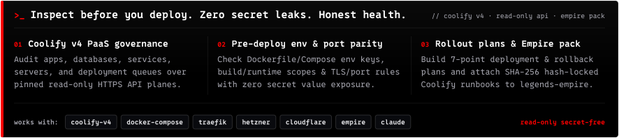
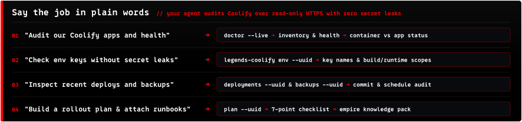
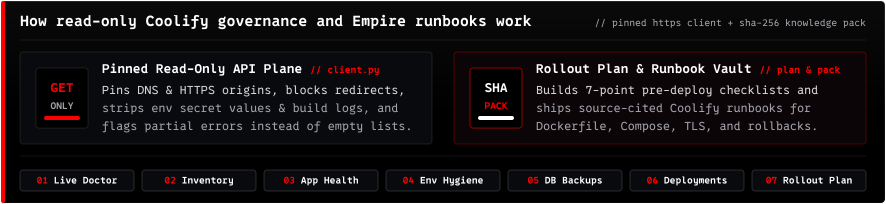
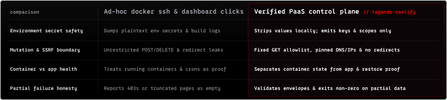

<a name="legends-coolify"></a>

# 

[](https://github.com/avalonreset/legends-coolify/releases/latest)
[](https://github.com/avalonreset/legends-coolify/actions/workflows/checks.yml)
[](docs/VALIDATION.md)
[](knowledge/coolify/pack.json)
[](LICENSE)

**Read-only Coolify v4 self-hosted PaaS governance CLI and source-cited runbook pack (`legends-coolify`) for coding agents: audit applications, databases, services, servers, and deployment queues over pinned HTTPS, verify Dockerfile/Compose environment keys and scopes with zero secret exposure, inspect backup schedules without mistaking cron configs for tested restores, and attach SHA-256 hash-locked Coolify operational runbooks to `legends-empire`.**


```text
Install or update legends-coolify via cto-legends (https://github.com/avalonreset/cto-legends): run `cto-legends install legends-coolify --apply`, then `cto-legends handoff legends-coolify` and follow the returned JSON recipe to verify `legends-coolify doctor`.
```



## Why `legends-coolify` exists

Handing a raw coding agent your Coolify API token or SSH shell and asking it to run ad-hoc curl calls or dashboard clicks creates three immediate production hazards:

1. **Plaintext secret and build-log leaks into chat context:** Standard Coolify environment and deployment endpoints return raw secret values, database passwords, and verbose build logs alongside key names. One unguarded curl call dumps production secrets straight into your agent transcript.
2. **Accidental mutations and redirect token leaks:** Without a fixed read-only route allowlist and pinned HTTPS transport, a mistyped HTTP method or unverified redirect can trigger an unreviewed deployment, restart a stateful Postgres container, or forward your Bearer token to an untrusted host.
3. **False confidence on container state, backups, and partial API failures:** Raw agents often see a `running` container or an `enabled: true` backup cron toggle and declare production safe, or treat a `403` permission error on one resource group as an empty inventory.

`legends-coolify` wraps your self-hosted [Coolify](https://coolify.io/) control plane in a zero-dependency, strictly read-only Python 3.11+ CLI paired with a source-cited operational runbook library ([wiki/index.md](wiki/index.md) and `knowledge/coolify/pack.json`). Every secret value and build log is stripped locally before output, every response envelope is checked for completeness, and every deployment plan is generated as a reviewable preflight and rollback checklist while humans authorize live changes through Coolify's official CLI, API, or UI.

## Ask in plain english

Once [`cto-legends`](https://github.com/avalonreset/cto-legends) is installed, you ask your coding agent in plain english. It verifies authenticated HTTPS readiness, collects secret-free metadata, and consults the source-cited Coolify runbooks before proposing any rollout:



- **"Audit our Coolify apps and health."** Runs `legends-coolify doctor --live`, then `inventory` and `health` across applications, databases, services, servers, and projects. Parses compound Docker statuses (`running:healthy`, `running:unhealthy`, `exited`) while explicitly separating container state from real application uptime.
- **"Check env keys without secret leaks."** Runs `legends-coolify env --uuid <app-uuid>` to list configured environment variable names and boolean lifecycle flags (`is_preview`, `is_runtime`, `is_buildtime`) with `values_included: false`, so your agent can verify Dockerfile and Docker Compose variable parity without ever seeing a secret value.
- **"Inspect recent deploys and backups."** Runs `legends-coolify deployments` (active queue, `--uuid` bounded history window, or `--deployment-uuid` single-commit outcome with logs stripped) and `legends-coolify backups --uuid <db-uuid>` (cron frequency, enabled state, and S3 flags with `restore_verified: false` until proven).
- **"Build a rollout plan & attach runbooks."** Runs `legends-coolify plan --uuid <app-uuid>` to generate a 7-point deployment, schema-migration, and rollback checklist, and resolves `legends-coolify resources` so you can read the runbooks directly or attach the SHA-256 hash-locked knowledge pack to [`legends-empire`](https://github.com/avalonreset/legends-empire).

## Architecture: pinned read-only API plane and SHA-256 runbook vault



### 1. Pinned read-only HTTPS transport and SSRF guard (`legends_coolify/client.py`)

Every live request passes through a hardened standard-library transport before a socket opens:

- **Fixed GET allowlist:** Only `/health`, `/version`, `/applications`, `/databases`, `/services`, `/servers`, `/projects`, `/applications/<uuid>`, `/applications/<uuid>/envs`, `/databases/<uuid>/backups`, `/deployments`, `/deployments/<uuid>`, and paginated `/deployments/applications/<uuid>?skip=M&take=N` are permitted. Every mutating or log-export endpoint is rejected offline before network access.
- **DNS pinning, redirect refusal, and proxy isolation:** The client requires verified `https://` origins without credentials, paths, or query strings, ignores ambient proxy environment variables, refuses all `3xx` redirects (`NoRedirect`), caps responses at `8 MiB`, and rejects duplicate JSON keys.
- **Loopback, metadata, and private-LAN controls:** Loopback (`localhost`, `127.0.0.0/8`, `::1`), unspecified (`0.0.0.0/8`), multicast, and cloud link-local metadata (`169.254.0.0/16`, `fe80::/10`) addresses are blocked unconditionally. Private RFC1918, IPv6 ULA, and Tailscale (`100.64.0.0/10`, `.ts.net`) origins are rejected by default unless you explicitly pass `--allow-private-host` (or set `COOLIFY_ALLOW_PRIVATE_HOST=1`) for an authorized private-LAN Coolify server.

### 2. CLI command surfaces (`legends-coolify`)

| Surface | `legends-coolify` Command | What It Verifies |
| :--- | :--- | :--- |
| **Offline & Live Readiness** | `doctor`, `doctor --live` | Offline package and knowledge-pack SHA-256 verification (`doctor`), or live `/health` check plus authenticated `/applications` UUID verification and `/version` readback (`doctor --live`). |
| **Estate Inventory & Health** | `inventory`, `health` | Whitelisted summaries across `applications`, `databases`, `services`, `servers`, and `projects`. Records per-endpoint errors as `"status": "partial"` (exit code `1`) rather than hiding failed collections as zero resources. |
| **Secret-Free Env Hygiene** | `env --uuid <app-uuid>` | Emits variable key names and `is_preview`, `is_runtime`, `is_buildtime` scope booleans with `values_included: false`. Never exports secret values even for variables marked public. |
| **Database Backup Schedules** | `backups --uuid <db-uuid>` | Emits schedule UUIDs, `enabled`, `frequency`, and `save_s3` flags alongside `restore_verified: false` and `execution_success_verified: false`. |
| **Deployment Queue & History** | `deployments [--uuid \| --deployment-uuid]` | Inspects queued/in-progress deployments, bounded per-app history windows (`--limit 1..50`, `--skip 0..100000`), or a single deployment UUID with normalized outcomes (`active`, `finished`, `failed`, `cancelled`) and zero build-log leakage. |
| **Advisory Rollout Checklist** | `plan --uuid <app-uuid>` | Verifies target application UUID identity and returns a 7-point pre-deployment, single-writer migration, and rollback checklist with `executed: false`. |
| **Knowledge Pack Discovery** | `resources` | Offline JSON resolution of `root`, `recipe`, `pack_dir`, `pack_manifest`, and `pack_files` across wheel installs (`package_data`) and source checkouts (`checkout`), verifying every file's SHA-256 hash. |

### 3. Attachable Empire knowledge pack and operational runbooks (`wiki/` & `knowledge/coolify/`)

Source and wheel installations bundle the complete source-cited Coolify operational library. You can browse [wiki/index.md](wiki/index.md) directly in GitHub or your code editor without credentials, or attach `knowledge/coolify/pack.json` (`legends.knowledge-pack/v1`) into a [`legends-empire`](https://github.com/avalonreset/legends-empire) vault shelf (`wiki/library/legends-coolify/coolify`) via hash-locked preview and apply. Runbooks cover API permissions, inventory and health layers, environment/TLS/CORS parity, database backup and restore proofs, single-writer migrations, PaaS version drift, and the boundary between [`legends-hetzner`](https://github.com/avalonreset/legends-hetzner), [`legends-cloudflare`](https://github.com/avalonreset/legends-cloudflare), and Coolify.

## Ad-hoc docker ssh & dashboard clicks vs `legends-coolify`



## Quick start

Set `COOLIFY_BASE_URL` to your HTTPS instance origin (for example `https://coolify.example.com`) and `COOLIFY_API_TOKEN` to a read-permission token loaded from your secret manager. Pass `--allow-private-host` (or `COOLIFY_ALLOW_PRIVATE_HOST=1`) only when inspecting an authorized private-LAN or Tailscale Coolify origin.

```sh
# 1. Verify offline knowledge pack integrity and live authenticated Coolify readiness
legends-coolify doctor
legends-coolify doctor --live

# 2. Audit full estate inventory and container health across apps, databases, and services
legends-coolify inventory
legends-coolify health

# 3. Inspect application environment variable keys and build/runtime scopes (zero secret values)
legends-coolify env --uuid YOUR_APPLICATION_UUID

# 4. Check database backup schedules and deployment queues or history windows
legends-coolify backups --uuid YOUR_DATABASE_UUID
legends-coolify deployments
legends-coolify deployments --uuid YOUR_APPLICATION_UUID --limit 10 --skip 0
legends-coolify deployments --deployment-uuid YOUR_DEPLOYMENT_UUID

# 5. Generate a 7-point pre-deployment and rollback checklist or resolve knowledge-pack paths
legends-coolify plan --uuid YOUR_APPLICATION_UUID
legends-coolify resources
```

Inspection commands emit JSON to standard output or write to a new private file with `--out /path/to/private/report.json` (`O_CREAT | O_EXCL`, mode `0600` on POSIX, refusing existing files, symlinks/junctions across the full ancestor chain, and Windows Controlled Folder Access directories).

## Reference

<details>
<summary><strong>Agent setup (via <code>cto-legends</code>) and standalone installation</strong></summary>

### Agent setup (via `cto-legends`)

The shared [`cto-legends`](https://github.com/avalonreset/cto-legends) skill discovers the module and loads its [agent recipe](docs/AGENT-RECIPE.md) on demand. It is the only registered skill; no additional module skill, MCP server, or model subscription is required by this package.

```sh
cto-legends sync --apply
cto-legends install legends-coolify --apply
cto-legends handoff legends-coolify
cto-legends run legends-coolify -- doctor
```

For an existing managed installation, use `cto-legends update legends-coolify --apply`. Omit `--apply` to preview installation or updates.

### Standalone install

Requires Python 3.11 or newer on Windows, macOS, or Linux using only the Python standard library. See [validation](docs/VALIDATION.md) for tested platforms and limits.

```sh
git clone https://github.com/avalonreset/legends-coolify.git
cd legends-coolify
python -m pip install .
legends-coolify doctor
legends-coolify resources
```

</details>

<details>
<summary><strong>Where it fits in the Legends ecosystem and optional <code>legends-empire</code> attachment</strong></summary>

| Component | Responsibility |
| :--- | :--- |
| [`legends-hetzner`](https://github.com/avalonreset/legends-hetzner) | Inspect, size, and provision Hetzner Cloud servers through hash-locked provider workflows. |
| [`legends-cloudflare`](https://github.com/avalonreset/legends-cloudflare) | Audit and govern DNS records, zone settings, and edge TLS routing. |
| [Coolify](https://coolify.io/) | Build and run applications, services, and databases on your chosen servers. |
| `legends-coolify` | Audit that Coolify platform over read-only HTTPS and guide your agent through source-cited operational runbooks. |
| [`legends-empire`](https://github.com/avalonreset/legends-empire) | Attach reusable module reference packs alongside your private project notes, decisions, and receipts. |
| [`cto-legends`](https://github.com/avalonreset/cto-legends) | Discover, install, update, and hand off every module through one central skill router. |

For optional [`legends-empire`](https://github.com/avalonreset/legends-empire) attachment, follow [the knowledge guide](docs/KNOWLEDGE.md) and [the attachment procedure](docs/KNOWLEDGE-PACK.md). Managed references remain separate from your private inventory, decisions, and receipts; updates preserve user notes and refuse conflicting reference edits fail-closed.

</details>

<details>
<summary><strong>Repository layout, verification, and FAQ</strong></summary>

| Location | Purpose |
| :--- | :--- |
| `wiki/` | Reusable source-cited Coolify operational runbooks and navigation ([wiki/index.md](wiki/index.md)) |
| `references/` | Dated source evidence and claim coverage ([references/sources.md](references/sources.md)) |
| `templates/` | Starting points for private operational records ([templates/private-operation-receipt.md](templates/private-operation-receipt.md)) |
| `knowledge/coolify/` | Versioned, SHA-256-pinned `legends-empire` reference pack ([knowledge/coolify/pack.json](knowledge/coolify/pack.json)) |
| `legends_coolify/` | Portable zero-dependency read-only Python CLI (`cli.py`, `client.py`, `resources.py`) |
| `tests/` | Hermetic transport, SSRF, output-safety, packaging-mirror, and knowledge-pack test suite |
| `skills/cto-legends/SKILL.md` | Pinned copy of the central [`cto-legends`](https://github.com/avalonreset/cto-legends) router skill |

```sh
python -m unittest discover -s tests -v
python scripts/check_release.py
python -m legends_coolify doctor
```

**Does `legends-coolify` deploy, restart, or mutate Coolify resources?**
No. `legends-coolify` is strictly read-only. It audits applications, databases, services, servers, environment variable metadata (never secret values), backup schedules, and deployment history, and generates advisory 7-point deployment checklists.

**Why does `legends-coolify` refuse HTTP, redirects, or unapproved private IPs?**
The transport requires verified HTTPS origins, pins resolved DNS IPs, refuses `3xx` redirects, and ignores ambient proxy variables so Bearer tokens are never forwarded over unverified links or leaked to internal metadata endpoints.

</details>

## Contributing, security, and license

Read [CONTRIBUTING.md](CONTRIBUTING.md), [AGENTS.md](AGENTS.md), [SECURITY.md](SECURITY.md), [PRIVACY.md](PRIVACY.md), and [docs/RELEASE.md](docs/RELEASE.md).

MIT licensed. Documentation links to upstream sources; no Coolify source code is bundled. See [NOTICE](NOTICE), [THIRD_PARTY_NOTICES.md](THIRD_PARTY_NOTICES.md), and [SUPPORT.md](SUPPORT.md).

[](https://github.com/avalonreset/cto-legends/issues/new?title=Message%20for%20Avalon%20Reset&labels=message)

<p align="center"><a href="https://github.com/stars/avalonreset/lists/cto-legends"></a></p>

**Specification & benchmarks on cto-legends.com:**
- **Module specification & architecture matrix:** [cto-legends.com/modules/legends-coolify](https://cto-legends.com/modules/legends-coolify)
- **Related engineering dispatches:** [Railway vs Render: Fly.io vs Self-Hosted Coolify PaaS](https://cto-legends.com/blog?post=railway-vs-render-fly-io-coolify-paas) · [Hetzner vs AWS & DigitalOcean: Cloud Server Planning](https://cto-legends.com/blog?post=hetzner-vs-aws-digitalocean-cloud-server-planning) · [How to Build AI Agents: Production CLI & MCP Routing](https://cto-legends.com/blog?post=how-to-build-ai-agents-cli-mcp-routing)
- **Ecosystem hub:** [cto-legends.com/home](https://cto-legends.com/home)
